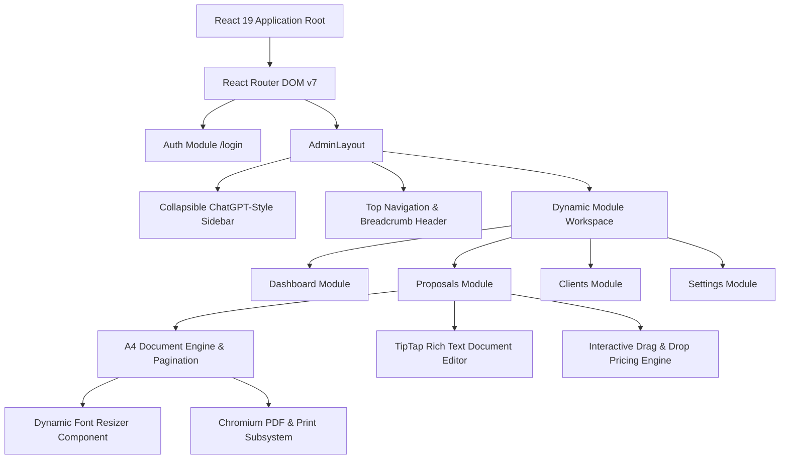
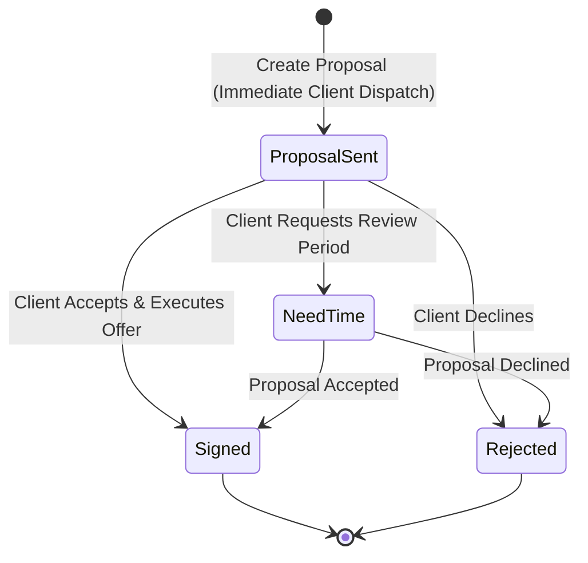

# ProposalOS Enterprise Admin — Frontend Technical Documentation

> **ProposalOS** is an enterprise-grade web application engineered for authoring, pricing, managing, and exporting pixel-perfect client proposals and commercial offers. Built with **React 19**, **Vite**, **Tailwind CSS v4**, **TipTap**, and **Zustand**, it features an automated physical A4 page-break calculation engine, multi-currency deliverable pricing, and streamlined workflow management.

---

## 1. Executive Architecture & Tech Stack



### Technology Matrix

| Layer | Technology | Version | Purpose |
| :--- | :--- | :--- | :--- |
| **Framework** | React | `^19.3.1` | Concurrent rendering, modern hooks, and functional components |
| **Build Tool** | Vite | `^8.3.6` | Lightning-fast HMR and optimized production bundling |
| **Styling** | Tailwind CSS | `^4.3.5` | Modern utility-first styling with native CSS variable cascades |
| **State Management** | Zustand | `^5.1.0` | Lightweight, decoupled reactive store architecture |
| **Routing** | React Router DOM | `^7.18.5` | Client-side routing, nested layouts, and route guards |
| **Rich Text Editor** | TipTap / ProseMirror | `^3.34.0` | Headless, extensible document editing with custom extensions |
| **Drag & Drop** | @dnd-kit (core, sortable) | `^6.3.1` | Accessible deliverable reordering in pricing schedules |
| **Iconography** | Lucide React | `^1.73.0` | High-fidelity, lightweight SVG icons |
| **Networking** | Axios | `^1.21.1` | HTTP client for backend API communication |

---

## 2. Directory Structure

```text
proposal-software-admin/
├── public/                     # Static public assets
├── src/
│   ├── assets/                 # Brand logos (Domine-Dude_black.png, fav-icon.png)
│   ├── components/
│   │   ├── common/             # Reusable UI primitives (Button, DataTable, Modal, Badge, etc.)
│   │   ├── document/           # Physical A4 pagination and print engine
│   │   │   ├── hooks/          # Document pagination, measurement, and settings hooks
│   │   │   ├── styles/         # CSS media rules (document.css, pagination.css, print.css)
│   │   │   ├── utils/          # A4 geometry, pixel-to-millimeter converters, block estimators
│   │   │   ├── DocumentCanvas.jsx       # Complete preview viewport with interactive toolbar
│   │   │   ├── DocumentContent.jsx      # Block-level document renderer
│   │   │   ├── DocumentFontResizer.jsx  # Interactive document typography & font scale widget
│   │   │   ├── DocumentFooter.jsx       # Calibrated footer with multi-line contact and page count
│   │   │   ├── DocumentHeader.jsx       # Header with logo routing and metadata
│   │   │   ├── DocumentPage.jsx         # Physical single-page container with margin clearances
│   │   │   ├── DocumentPagination.jsx   # Offscreen DOM measurement sandbox and paginator
│   │   │   └── DocumentSettings.jsx     # Slide-over drawer for orientation, margins, watermarks
│   │   ├── editor/             # TipTap Rich Text Editor extensions, bubble menus, and toolbar
│   │   └── layout/             # AdminLayout, Header, and ChatGPT-style Sidebar
│   ├── modules/
│   │   ├── auth/               # Split-screen Login page with enterprise branding
│   │   ├── Dashboard/          # KPI stats, recent proposals, and pipeline analytics
│   │   ├── clients/            # Client directory, CRM profiles, and client creation
│   │   ├── pricing/            # Milestones, itemized deliverables, discounts, and taxes
│   │   ├── proposals/          # Proposal lifecycle, builder wizard, preview, and tables
│   │   └── settings/           # Company Profile, Document Layout, and Currency Defaults
│   ├── services/               # Mock and HTTP API service layers
│   ├── store/                  # Global application store
│   ├── App.jsx                 # Central router definitions
│   ├── index.css               # Base Tailwind CSS styles and reset rules
│   └── main.jsx                # Application bootstrap
├── package.json
└── vite.config.js
```

---

## 3. Core Modules & Subsystems

### 3.1. Proposals Module (`src/modules/proposals`)

The Proposals module is the primary workspace for creating, itemizing, tracking, and distributing commercial offers.

#### Proposal Lifecycle State Machine
Every proposal belongs to one of four production statuses, controlled via the interactive `ProposalStatusDropdown`:



- **`proposal_sent` (Proposal Sent)**: Blue badge (`bg-blue-50 text-blue-700 border-blue-200`). Default status upon creation since proposals are immediately shared with the client.
- **`need_time` (Need Time)**: Amber badge (`bg-amber-50 text-amber-700 border-amber-200`). Represents active consideration/follow-up.
- **`signed` (Signed)**: Emerald badge (`bg-emerald-50 text-emerald-800 border-emerald-200`). Indicates signed contract/closed deal.
- **`rejected` (Rejected)**: Red badge (`bg-red-50 text-red-700 border-red-200`). Indicates declined proposal.

#### Direct Table Actions
In the Proposals table (`ProposalTable.jsx`), the previous 3-dots dropdown was replaced with direct, high-efficiency icon buttons:
- **Preview (`Eye`)**: Opens the physical A4 document preview.
- **Edit (`Edit3`)**: Navigates to the multi-tab proposal editor.
- **Export PDF (`FileDown`)**: Triggers immediate Chromium PDF generation.
- **Duplicate (`Copy`)**: Clones proposal configuration and pricing into a new draft.
- **Delete (`Trash2`)**: Prompts confirmation modal with danger warning.

---

### 3.2. Document Engine & Physical A4 Pagination (`src/components/document`)

The document engine solves one of the hardest problems in web software: **guaranteeing that browser previews match printed A4 sheets with zero broken blocks or split tables.**

#### Physical Geometry & Margins

| Dimension / Zone | Physical Size | Screen Equiv (96 DPI) | Purpose |
| :--- | :--- | :--- | :--- |
| **A4 Width** | `210.0 mm` | `793.7 px` | Fixed page width in portrait |
| **A4 Height** | `297.0 mm` | `1122.5 px` | Fixed page height in portrait |
| **Top Margin Clearance** | `35.0 mm` | `132.3 px` | Header height (22mm) + clearance buffer |
| **Bottom Margin Clearance** | `25.0 mm` | `94.5 px` | Footer height (16mm) + clearance buffer |
| **Left / Right Margin** | `18.0 mm` | `68.0 px` | Clean lateral reading gutter |
| **Usable Content Area** | `174.0 mm × 237.0 mm` | `657.6 px × 895.7 px` | Sits strictly between header and footer |

#### Dual-Pass Pagination Algorithm
1. **Pass 1 — Offscreen DOM Sandbox Measurement**:
   - The unpaginated document content is rendered inside an invisible measurement sandbox (`.document-measurement-sandbox`) at exactly `174mm` width.
   - Using `measureDOMBlocks()`, actual rendered element heights (including margins and image loads) are calculated.
2. **Pass 2 — Greedy Bin-Packing with Block Splitting**:
   - Blocks are grouped into sequential pages using `calculatePages()`.
   - Large pricing tables are split across page boundaries without clipping or hiding table headers.
   - Forced `pageBreak` nodes immediately initiate a fresh A4 container.

#### Document Typography & Font Resizing Component (`DocumentFontResizer.jsx`)
- Positioned directly on the document canvas toolbar and within the Page Setup drawer.
- Allows 1-click resizing across standard presets: `10px` (Compact), `11px` (Small), `12px` (Default), `13px` (Medium), `14px` (Comfortable), `15px` (Large), `16px` (Extra Large).
- Injects CSS custom properties (`--doc-base-size`, `--doc-h1-size`, `--doc-h2-size`, `--doc-h3-size`) into `.document-content-area` and the measurement sandbox.
- **Live Recalculation**: Changing the font scale triggers the `ResizeObserver`, instantly re-paginating the document for both preview and PDF output.

#### Dynamic Logo Routing
- **Direct Client Proposals**: Displays full company branding in the top header.
- **B2B Proposals**: The company logo is omitted while strictly preserving identical header height, typography, and page layout.

---

### 3.3. Pricing & Commercial Calculation Engine (`src/modules/pricing`)

- **Multi-Currency Support**: Supports `INR (₹)`, `USD ($)`, `EUR (€)`, `GBP (£)`, `AED (د.إ)`, `SGD ($)`, `AUD ($)`, `CAD ($)`.
- **Itemized Deliverables**: Includes quantity, milestone units, unit price, item-level discounts, and tax rates.
- **Financial Aggregation**: Computes Net Investment, Subtotals, Itemized Tax breakdowns, and Grand Total with currency formatting.

---

### 3.4. Layout & Navigation (`src/components/layout`)

#### ChatGPT-Style Sidebar (`Sidebar.jsx`)
- **Collapsed Mode**:
  - Displays the brand mark (`fav-icon.png`) crisp and clean without fading.
  - Hovering the sidebar reveals a floating chevron expand handle on the border edge.
  - Sidebar background uses standard arrow cursor (`cursor-default`), matching the ChatGPT desktop experience.
  - Navigation icons display floating, high-contrast tooltips with directional arrows on hover (`z-[100]`).
- **Expanded Mode**:
  - Displays full brand logo (`Domine-Dude_black.png`).
  - Organized by **Workspace** and **Management** navigation sections.
  - Shows active indicator pill and counter badges.

---

## 4. Key Utilities & Helper References

| Utility File | Primary Functions |
| :--- | :--- |
| `src/modules/proposals/utils/proposalHelpers.js` | `createNewProposalModel`, `calculateProposalTotals`, `formatCurrency`, `convertProposalToDocumentCanvasProps`, `getProposalStatusConfig` |
| `src/components/document/utils/a4Config.js` | `A4_CONFIG`, `mmToPx`, `pxToMm`, `getUsableContentArea` |
| `src/components/document/utils/contentMeasurement.js` | `measureDOMBlocks`, `waitForImages`, `estimateBlockHeight` |
| `src/components/document/utils/pageCalculator.js` | `calculatePages` (greedy A4 block bin-packing) |
| `src/modules/clients/utils/clientHelpers.js` | `getClientInitials`, client search and filter helpers |

---

## 5. Development & Deployment Guide

### Prerequisites
- **Node.js**: v18.0.0 or higher
- **Package Manager**: `pnpm` (recommended), `npm`, or `yarn`

### Installation & Run

```bash
# 1. Install dependencies
pnpm install

# 2. Start local development server with Vite HMR
pnpm dev

# 3. Compile optimized production build
pnpm build

# 4. Preview the production build locally
pnpm preview
```

### Production Build Outputs
Vite produces clean, compressed assets in the `dist/` folder:
- `dist/index.html` (Application HTML entry point)
- `dist/assets/index-[hash].css` (Compiled Tailwind CSS bundle)
- `dist/assets/index-[hash].js` (Vendor and application bundles)
- `dist/assets/*.png` (Optimized brand imagery)

---

## 6. PDF Generation & Print Media Specifications

The application uses CSS Paged Media rules inside `src/components/document/styles/print.css`:

```css
@media print {
  @page {
    size: A4 portrait;
    margin: 0;
  }

  body {
    background: #FFFFFF !important;
    margin: 0;
    padding: 0;
  }

  .no-print,
  .document-canvas-toolbar,
  aside,
  header {
    display: none !important;
  }

  .document-page {
    page-break-after: always;
    break-after: page;
    box-shadow: none !important;
  }
}
```

This guarantees identical output whether exported via the backend Chromium Browsershot service or printed directly through the browser.
