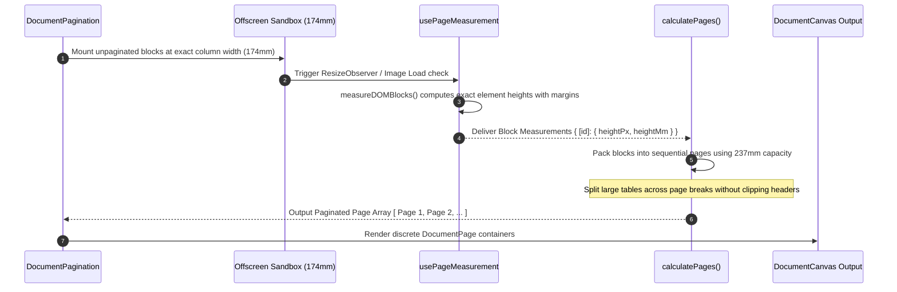
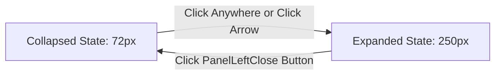
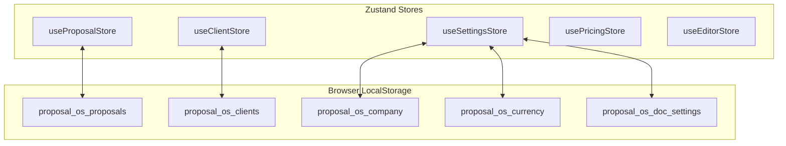

# ProposalOS Enterprise Admin — Comprehensive Technical Documentation & Architecture Reference

> **ProposalOS** is an enterprise-grade commercial proposal authoring, pricing, lifecycle tracking, and PDF document publishing software. Engineered with **React 19**, **Vite**, **Tailwind CSS v4**, **TipTap**, and **Zustand**, it features a calibrated physical A4 page-break calculation engine, multi-currency deliverable pricing with drag-and-drop sequencing, and intelligent logo routing for Direct Client vs. B2B white-label agreements.

---

## 1. Executive Summary & System Architecture

ProposalOS bridges the gap between web-based WYSIWYG editing and physical document printing. While standard web printing engines suffer from clipped text, sliced tables, and unpredictable page breaks, ProposalOS incorporates a **dual-pass physical page calculation engine** that models A4 dimensions down to fractional millimeters and pixels, guaranteeing identical rendering between browser preview, physical print, and Chromium PDF exports.

```mermaid
graph TD
    subgraph Client Application [React 19 Single Page App]
        Router[React Router DOM v7]
        StoreLayer[Reactive Store Layer - Zustand]
        LayoutLayer[AdminLayout System]
        
        Router --> AuthRoute[/login - Split Screen Auth]
        Router --> LayoutLayer
        
        LayoutLayer --> Sidebar[ChatGPT-Style Collapsible Sidebar]
        LayoutLayer --> Header[Workspace Topbar & Global Search]
        LayoutLayer --> Views[Active Module Route]
    end

    subgraph Module Layer [Core Business Modules]
        Views --> ModProposals[Proposals Module]
        Views --> ModClients[Clients CRM Module]
        Views --> ModDashboard[Dashboard Analytics]
        Views --> ModSettings[System & Company Settings]
    end

    subgraph Document Engine [Physical A4 Engine]
        ModProposals --> DocCanvas[DocumentCanvas & Toolbar]
        DocCanvas --> FontResizer[DocumentFontResizer Component]
        DocCanvas --> Paginator[DocumentPagination Engine]
        
        Paginator --> Pass1[Pass 1: Offscreen DOM Measurement Sandbox]
        Pass1 --> Pass2[Pass 2: Greedy Bin-Packing & Table Splitting]
        Pass2 --> PhysicalPages[Calibrated DocumentPage Containers]
        PhysicalPages --> PrintOut[Print & Chromium PDF Engine]
    end

    subgraph Editor Engine [TipTap & ProseMirror]
        ModProposals --> TipTapEditor[TipTap Rich Text Subsystem]
        TipTapEditor --> CustomBlocks[Custom Callouts, Stats & Blockquotes]
        TipTapEditor --> EditableTables[Interactive Matrix Tables]
        TipTapEditor --> FloatingMenus[Bubble & Floating Format Bars]
    end

    subgraph Pricing Engine [Commercial Calculation Engine]
        ModProposals --> PricingModule[PricingTable Subsystem]
        PricingModule --> DnD[@dnd-kit Sortable Row Engine]
        PricingModule --> CurrencyCalc[Multi-Currency & Tax Engine]
    end
```

---

## 2. Technology Stack & Dependency Matrix

The project strictly adheres to modern frontend engineering standards:

| Dependency | Version | Architectural Role & Implementation Details |
| :--- | :--- | :--- |
| **react** | `^19.3.1` | Root UI framework utilizing concurrent rendering, strict mode stability, and performance hooks (`useMemo`, `useCallback`, `useRef`). |
| **react-dom** | `^19.3.1` | DOM renderer targeting modern evergreen browsers. |
| **vite** | `^8.3.6` | Next-generation bundler delivering near-instant HMR, tree-shaking, and Rollup-based production chunking. |
| **react-router-dom** | `^7.18.5` | Central declarative routing with nested layout routes, parameter extractors (`useParams`), and query-string synchronization. |
| **tailwindcss** | `^4.3.5` | Utility styling engine leveraging CSS custom property cascades, responsive breakpoints, and print-media isolation. |
| **@tailwindcss/vite** | `^4.3.5` | Direct Vite compiler integration for instant CSS transformation. |
| **zustand** | `^5.1.0` | Decentralized, boilerplate-free state stores with localStorage persistence and reactive selectors. |
| **@tiptap/react** | `^3.34.0` | Headless ProseMirror wrapper enabling custom schema nodes, marks, and controlled document updates. |
| **@tiptap/starter-kit** | `^3.34.0` | Standard document typography extensions (headings, paragraphs, bold, italic, bullet lists, ordered lists). |
| **@tiptap/extension-table** | `^3.34.0` | ProseMirror table node support with dynamic column resizing and cell manipulations. |
| **@dnd-kit/core** | `^6.3.1` | Accessible drag-and-drop collision detection and pointer/keyboard sensors. |
| **@dnd-kit/sortable** | `^10.0.0` | Vertical sorting strategy for milestone pricing rows. |
| **lucide-react** | `^1.73.0` | Iconography suite with uniform stroke-widths, SVG tree-shaking, and accessibility labels. |
| **axios** | `^1.21.1` | Configurable HTTP client with interceptors for auth tokens, retry strategies, and error handling. |

---

## 3. Project Directory Map & File Manifest

An exhaustive index of every single file within `src/` and its structural responsibility:

```
src/
├── App.css                                 # App-level base overrides
├── App.jsx                                 # Central route configuration and route guards
├── index.css                               # Tailwind v4 directives, typography classes, font families
├── main.jsx                                # Application mount point and React 19 root bootstrap
│
├── assets/
│   ├── Domine-Dude_black.png               # Full brand horizontal logo (dark text) for expanded sidebar
│   ├── Domine Dude_white.png               # Light variant for dark contexts
│   ├── Domine-Dude_black-icon.png          # High-resolution square icon
│   └── fav-icon.png                        # Core brand favicon mark used in collapsed sidebar
│
├── components/
│   ├── common/                             # Universal Reusable UI Components
│   │   ├── ActionMenu.jsx                  # Dropdown menu wrapper with click-away listener
│   │   ├── Avatar.jsx                      # User profile avatar with initials fallback and status dot
│   │   ├── Badge.jsx                       # Capsule badge with color variants (info, warning, danger, success)
│   │   ├── Breadcrumb.jsx                  # Dynamic navigational breadcrumb trail
│   │   ├── Button.jsx                      # Button primitive with size, icon, loading, and variant states
│   │   ├── ConfirmDialog.jsx               # Modal dialog for destructive actions (Delete confirmation)
│   │   ├── CurrencyInput.jsx               # Formatted monetary input field with currency prefix
│   │   ├── DataTable.jsx                   # High-performance table with sorting, selection, and empty states
│   │   ├── DatePicker.jsx                  # HTML5 native date picker with styled calendar wrapper
│   │   ├── Dropdown.jsx                    # Selectable floating option menu
│   │   ├── EmptyState.jsx                  # Illustrated placeholder for empty lists or searches
│   │   ├── FileUpload.jsx                  # Drag-and-drop file upload zone with preview
│   │   ├── FilterBar.jsx                   # Horizontal filter container with search and select controls
│   │   ├── FormField.jsx                   # Form wrapper component providing label, hint, and error text
│   │   ├── Input.jsx                       # Standardized single-line text input
│   │   ├── LoadingSpinner.jsx              # Accessible SVG loading spinner
│   │   ├── Modal.jsx                       # Accessible dialog with backdrop blur and escape-key listener
│   │   ├── PageHeader.jsx                  # Top-of-page header with title, subtitle, and action buttons
│   │   ├── Pagination.jsx                  # Page numbers, next/prev buttons, and row count indicators
│   │   ├── SearchInput.jsx                 # Search input with clear button and debounced callback
│   │   ├── SectionHeader.jsx               # Divider header for form sections
│   │   ├── Select.jsx                      # Styled custom dropdown selector
│   │   ├── StatsCard.jsx                   # KPI metric card with trend indicators and Lucide icon
│   │   ├── StatusBadge.jsx                 # Proposal status capsule pill renderer
│   │   ├── Textarea.jsx                    # Multi-line autosizing textarea
│   │   ├── Tooltip.jsx                     # Hover tooltip with auto-positioning
│   │   └── index.js                        # Barrel export for all common components
│   │
│   ├── document/                           # Physical A4 Pagination & PDF Publishing Subsystem
│   │   ├── DocumentCanvas.jsx              # Full-page document preview container with interactive topbar
│   │   ├── DocumentContent.jsx             # Renders normalized blocks into styled DOM elements
│   │   ├── DocumentFontResizer.jsx         # Interactive document typography & font-scale widget
│   │   ├── DocumentFooter.jsx              # Fixed footer with address, contact lines, and page counts
│   │   ├── DocumentHeader.jsx              # Fixed header with logo routing, proposal ID, and date
│   │   ├── DocumentPage.jsx                # Physical single-page container with calibrated margins
│   │   ├── DocumentPageBreak.jsx           # Forced visual/print page break divider
│   │   ├── DocumentPageNumber.jsx          # Page number counter formatter ("Page 01 of 02")
│   │   ├── DocumentPagination.jsx          # Measurement sandbox and paginated pages controller
│   │   ├── DocumentSettings.jsx            # Slide-over drawer for orientation, margins, and typography
│   │   ├── DocumentWatermark.jsx           # Rotated diagonal watermark overlay layer
│   │   ├── index.js                        # Barrel export for document components and utilities
│   │   ├── hooks/
│   │   │   ├── useDocumentPagination.js    # Orchestrates DOM measurement and page grouping
│   │   │   ├── useDocumentSettings.js      # Manages document margins, orientation, and typography
│   │   │   └── usePageMeasurement.js       # ResizeObserver and element height measurement hook
│   │   ├── styles/
│   │   │   ├── document.css                # Visual canvas styling and sheet shadows
│   │   │   ├── pagination.css              # Document typography classes and CSS variable links
│   │   │   └── print.css                   # CSS Paged Media `@media print` rules
│   │   └── utils/
│   │       ├── a4Config.js                 # Physical A4 constants, conversions (mm <-> px), margins
│   │       ├── contentMeasurement.js       # Heuristic and DOM element height measurement
│   │       ├── documentHelpers.js          # TipTap AST to document block normalizer & sample data
│   │       └── pageCalculator.js           # Greedy bin-packing algorithm with table splitting
│   │
│   ├── editor/                             # TipTap Rich Text Document Editor
│   │   ├── EditorBubbleMenu.jsx            # Inline text formatting menu on selection (Bold, Italic, Link)
│   │   ├── EditorContent.jsx               # ProseMirror content editable container
│   │   ├── EditorFloatingMenu.jsx          # Line-start floating menu for adding headings, lists, tables
│   │   ├── EditorToolbar.jsx               # Top fixed formatting toolbar
│   │   ├── TipTapEditor.jsx                # Unified rich-text editor integrating all extensions
│   │   ├── index.js                        # Editor barrel export
│   │   ├── extensions/
│   │   │   ├── CustomBlockExtension.js     # Custom TipTap nodes for callout boxes and alert panels
│   │   │   ├── PageBreakExtension.js       # Custom TipTap node for manual page breaks
│   │   │   └── editorExtensions.js         # Extension manifest configuring starter kit and tables
│   │   ├── hooks/
│   │   │   ├── useEditorCommands.js        # Command dispatcher for formatting and node insertion
│   │   │   └── useEditorContent.js         # Content state synchronizer
│   │   ├── modals/
│   │   │   ├── ImageInsertModal.jsx        # Dialog for adding images with URL and caption
│   │   │   └── LinkInsertModal.jsx         # Dialog for adding hyperlinks
│   │   ├── store/
│   │   │   └── editorStore.js              # Active editor state, word count, character count
│   │   ├── styles/
│   │   │   └── editor.css                  # ProseMirror typography and cursor styling
│   │   ├── table/
│   │   │   ├── EditableTable.jsx           # Controlled interactive table component
│   │   │   ├── TableCellMenu.jsx           # Context menu for adding/deleting rows and columns
│   │   │   ├── TableToolbar.jsx            # Table manipulation controls
│   │   │   └── tablePresets.js             # Predefined matrix templates (comparison, scope, SLA)
│   │   └── utils/
│   │       └── sampleDocJson.js            # Initial proposal document ProseMirror AST template
│   │
│   └── layout/                             # Workspace Shell & Navigation Architecture
│       ├── AdminLayout.jsx                 # Master layout template wrapping Sidebar, Header, and Outlet
│       ├── Header.jsx                      # Top navigation bar with breadcrumbs and user menu
│       └── Sidebar.jsx                     # Collapsible ChatGPT-style navigation sidebar
│
├── modules/
│   ├── auth/                               # Authentication Subsystem
│   │   ├── Login.jsx                       # Split-screen enterprise login interface
│   │   └── index.js                        # Auth barrel export
│   │
│   ├── Dashboard/                          # Analytics & Overview
│   │   ├── Dashboard.jsx                   # KPI metrics, quick actions, and recent proposals
│   │   └── index.js                        # Dashboard barrel export
│   │
│   ├── clients/                            # Client Relationship Management (CRM)
│   │   ├── index.js                        # Clients barrel export
│   │   ├── components/
│   │   │   ├── ClientActions.jsx           # Action toolbar for clients page
│   │   │   ├── ClientCard.jsx              # Summary card for a client
│   │   │   ├── ClientDetails.jsx           # Detailed client view showing historical proposals
│   │   │   ├── ClientForm.jsx              # Multi-field form for creating and editing clients
│   │   │   ├── ClientSearch.jsx            # Filter search box for clients directory
│   │   │   └── ClientTable.jsx             # Clients DataTable with 1-click action buttons
│   │   ├── hooks/
│   │   │   └── useClients.js               # Client business logic and state wrapper
│   │   ├── pages/
│   │   │   ├── ClientList.jsx              # Main clients directory page
│   │   │   ├── CreateClient.jsx            # New client creation page
│   │   │   └── EditClient.jsx              # Client profile editor page
│   │   ├── services/
│   │   │   └── clientService.js            # Client HTTP / localStorage persistence service
│   │   ├── store/
│   │   │   └── clientStore.js              # Zustand store for clients collection and selection
│   │   └── utils/
│   │       └── clientHelpers.js            # Initials generator and client search utilities
│   │
│   ├── pricing/                            # Interactive Pricing & Deliverables Schedule
│   │   ├── index.js                        # Pricing barrel export
│   │   ├── components/
│   │   │   ├── CurrencySelector.jsx        # Dropdown for selecting transaction currency
│   │   │   ├── DiscountInput.jsx           # Percentage or fixed discount control
│   │   │   ├── PricingRow.jsx              # Drag-and-drop sortable pricing row item
│   │   │   ├── PricingSettings.jsx         # Tax mode (flat vs itemized) and currency settings
│   │   │   ├── PricingSummary.jsx          # Net investment, taxes, and grand total breakdown
│   │   │   ├── PricingTable.jsx            # DnD sortable pricing table container
│   │   │   ├── PricingToolbar.jsx          # Controls for adding items and presets
│   │   │   └── TaxInput.jsx                # Tax rate input with common presets (18%, 10%, 5%)
│   │   ├── hooks/
│   │   │   └── usePricing.js               # Hook wrapping pricing calculations and modifications
│   │   ├── services/
│   │   │   └── pricingService.js           # Pricing calculation service
│   │   ├── store/
│   │   │   └── pricingStore.js             # Active pricing state, currency, and item list
│   │   └── utils/
│   │       ├── currencyHelpers.js          # Currency symbols, codes, and number formatters
│   │       ├── pricingCalculations.js      # Arithmetic calculation of subtotals and discounts
│   │       └── taxHelpers.js               # Tax calculation algorithms
│   │
│   ├── proposals/                          # Core Proposals Management Subsystem
│   │   ├── index.js                        # Proposals barrel export
│   │   ├── components/
│   │   │   ├── ClientDetailsForm.jsx       # Client contact selector/entry inside wizard
│   │   │   ├── CompanyDetailsForm.jsx      # Company branding and address selector
│   │   │   ├── ProposalActions.jsx         # Action buttons (Save, Export, Print)
│   │   │   ├── ProposalEditorPanel.jsx     # Tab wrapper for Rich Text proposal content
│   │   │   ├── ProposalForm.jsx            # Multi-step wizard coordinator
│   │   │   ├── ProposalInformation.jsx     # Proposal title, ID, date, and Direct/B2B toggle
│   │   │   ├── ProposalPricing.jsx         # Pricing schedule tab inside proposal editor
│   │   │   ├── ProposalStatusDropdown.jsx  # Interactive capsule dropdown for proposal status
│   │   │   ├── ProposalSummary.jsx         # Executive summary view before publishing
│   │   │   └── ProposalTable.jsx           # Proposals DataTable with direct action icons
│   │   ├── hooks/
│   │   │   └── useProposal.js              # Proposal manipulation hook
│   │   ├── pages/
│   │   │   ├── CreateProposal.jsx          # Proposal creation builder page
│   │   │   ├── EditProposal.jsx            # Proposal modification page
│   │   │   ├── ProposalList.jsx            # Master proposals directory and stats
│   │   │   └── ProposalPreview.jsx         # Full-screen A4 document preview and export page
│   │   ├── services/
│   │   │   └── proposalService.js          # Proposals CRUD operations and mock database
│   │   ├── store/
│   │   │   └── proposalStore.js            # Zustand proposal store with status updater
│   │   └── utils/
│   │       └── proposalHelpers.js          # Model generators, totals, statuses, and transformers
│   │
│   └── settings/                           # Global Application & Company Settings
│       ├── index.js                        # Settings barrel export
│       ├── components/
│       │   ├── AddressForm.jsx             # Multi-line company physical address form
│       │   ├── CompanyContactForm.jsx      # Multi-line phone, email, and website fields
│       │   ├── CompanyLogoUpload.jsx       # Direct image upload and storage for brand logo
│       │   ├── CompanyProfileForm.jsx      # Master organization information editor
│       │   ├── DefaultCurrencySelector.jsx # Global default transaction currency selector
│       │   ├── DocumentFooterSettings.jsx  # Document footer template and clearance setup
│       │   └── DocumentHeaderSettings.jsx  # Document header template and branding setup
│       ├── hooks/
│       │   └── useSettings.js              # Settings access and update hook
│       ├── pages/
│       │   ├── AccountSettings.jsx         # User profile and password preferences
│       │   ├── CompanyProfile.jsx          # Organization branding and legal entity setup
│       │   ├── CurrencySettings.jsx        # Default currency and validity day rules
│       │   ├── DocumentSettings.jsx        # Global document layout margin defaults
│       │   └── SettingsPage.jsx            # Tabbed master settings view
│       ├── services/
│       │   └── settingsService.js          # Settings persistence layer
│       ├── store/
│       │   └── settingsStore.js            # Zustand settings store
│       └── utils/
│           └── settingsHelpers.js          # Settings validation and normalization
│
├── services/
│   ├── api.js                              # Base Axios HTTP client instance
│   └── proposalService.js                  # Shared proposal API client
│
├── store/
│   └── proposalStore.js                    # Global store root export
│
└── utils/
    └── proposalHelpers.js                  # Global utility root export
```

---

## 4. Routing Architecture & Page Controllers

The application routes are defined in `src/App.jsx` using `react-router-dom`:

| Route Path | View Controller | Access Guard | Primary Capability |
| :--- | :--- | :--- | :--- |
| `/login` | `Login` | Public | Split-screen enterprise authentication with credentials login. |
| `/` | `Dashboard` | Authenticated | Pipeline metrics, acceptance rates, revenue, and quick actions. |
| `/dashboard` | `Dashboard` | Authenticated | Alias to primary KPI dashboard. |
| `/proposals` | `ProposalList` | Authenticated | Proposals master directory with search, status filtering, and 1-click actions. |
| `/proposals/new` | `CreateProposal` | Authenticated | 4-tab proposal builder wizard (Info, Scope, Pricing, Review). |
| `/proposals/create`| `CreateProposal` | Authenticated | Route alias for proposal builder. |
| `/proposals/:id/edit` | `EditProposal` | Authenticated | Live editing of existing proposal content, pricing, and client details. |
| `/proposals/:id/preview`| `ProposalPreview`| Authenticated | Calibrated physical A4 preview with toolbar, zoom, font resizing, and PDF export. |
| `/proposals/:id` | `ProposalPreview` | Authenticated | Route alias for proposal preview. |
| `/clients` | `ClientList` | Authenticated | Clients directory with status indicators (Active, Lead, Inactive) and search. |
| `/clients/new` | `CreateClient` | Authenticated | Form to register a new client and tax ID. |
| `/clients/:id/edit`| `EditClient` | Authenticated | Client profile and contact information editor. |
| `/settings` | `SettingsPage` | Authenticated | Master tabbed settings layout. |
| `/settings/company`| `CompanyProfile` | Authenticated | Organization legal identity, multi-line address, and branding logos. |
| `/settings/documents`| `DocumentSettings`| Authenticated | Calibrated margin clearances, header/footer height configurations. |
| `/settings/currency` | `CurrencySettings`| Authenticated | Default currency, validity periods, and exchange rules. |
| `/settings/account`| `AccountSettings` | Authenticated | Current user profile, credentials, and notifications. |

---

## 5. Physical A4 Document Engine & Pagination Subsystem

The document engine (`src/components/document`) is the technical cornerstone of the application. It guarantees strict physical page fidelity across all display and export environments.

### 5.1. Geometric Constants (`a4Config.js`)
All dimensions are calibrated to the ISO 216 standard for A4 paper:

$$\text{Width} = 210.0\text{ mm} \approx 793.7\text{ px}$$
$$\text{Height} = 297.0\text{ mm} \approx 1122.5\text{ px}$$
$$\text{Conversion Ratio} = \frac{96\text{ DPI}}{25.4\text{ mm/inch}} \approx 3.779527559\text{ px/mm}$$

```javascript
export const A4_CONFIG = {
  widthMm: 210,
  heightMm: 297,
  margins: {
    top: 35,      // 35mm clearance: reserved for 22mm header + buffer
    bottom: 25,   // 25mm clearance: reserved for 16mm footer + buffer
    left: 18,     // 18mm lateral margins
    right: 18,
  },
  header: {
    height: 22,   // 22mm physical header
  },
  footer: {
    height: 16,   // 16mm physical footer
  },
}
```

$$\text{Usable Content Width} = 210\text{ mm} - (18\text{ mm} + 18\text{ mm}) = 174\text{ mm} \approx 657.6\text{ px}$$
$$\text{Usable Content Height} = 297\text{ mm} - (35\text{ mm} + 25\text{ mm}) = 237\text{ mm} \approx 895.7\text{ px}$$

### 5.2. Dual-Pass Pagination Algorithm



1. **Pass 1 — Offscreen Sandbox DOM Measurement**:
   - Blocks are mounted inside `.document-measurement-sandbox` with an exact physical width of `174mm`.
   - `waitForImages()` verifies all embedded diagrams and assets are loaded before height sampling.
   - `measureDOMBlocks()` calculates `rect.height + marginTop + marginBottom` for each `data-block-id`.
2. **Pass 2 — Greedy Bin-Packing (`pageCalculator.js`)**:
   - Pages maintain a vertical capacity limit of `237mm`.
   - Blocks are added sequentially. If adding a block exceeds `237mm`:
     - If the block is a `table`, its rows are split: rows that fit stay on the current page, while remaining rows move to the next page with a cloned table header.
     - For other blocks, a new page container is initialized.
   - `pageBreak` nodes immediately trigger a new page container.

### 5.3. Document Font Resizing Component (`DocumentFontResizer.jsx`)

The document toolbar features a dynamic typography scaling component:
- **Decrease Button (`-`)**: Decrements base body font size by 1px (minimum: `9px`).
- **Font Size Pill & Preset Menu**: Direct preset selection:
  - `10px` (Compact)
  - `11px` (Small)
  - `12px` (Standard / Default)
  - `13px` (Medium)
  - `14px` (Comfortable)
  - `15px` (Large)
  - `16px` (Extra Large)
- **Increase Button (`+`)**: Increments base body font size by 1px (maximum: `18px`).
- **Reset Button**: Appears when font size differs from `12px`, restoring default settings in 1 click.
- **Dynamic Variable Ingestion**: Updates `--doc-base-size`, `--doc-h1-size`, `--doc-h2-size`, and `--doc-h3-size` CSS variables on `.document-content-area` and `.document-measurement-sandbox`.
- **Immediate Recalculation**: Changing the font size triggers the `ResizeObserver` inside `usePageMeasurement`, recalculating page heights and updating page counts in real time.

### 5.4. Document Header & Footer Specifications
- **Header (`DocumentHeader.jsx`)**:
  - Displays company logo on **Direct Client Proposals**.
  - Omit logo on **B2B Proposals** while strictly preserving identical `22mm` header clearance and typography.
  - Right-aligned metadata includes proposal number and formatted generated date with validity deadline.
  - Divided by a subtle light-grey border line (`border-b border-gray-200`).
- **Footer (`DocumentFooter.jsx`)**:
  - Left column: Multi-line registered company phone numbers.
  - Middle column: Formatted page number indicator (`Page 01 of 02`).
  - Right column: Multi-line physical corporate office address.
  - Divided by a light-grey border line (`border-t border-gray-200`).

---

## 6. Proposals Module Architecture

### 6.1. Proposal Data Model Schema

```typescript
interface ProposalModel {
  id: string;                     // Unique internal ID (e.g., 'prop-1732174829102')
  number: string;                 // Display ID (e.g., 'PROP-2026-081')
  title: string;                  // Commercial offer title
  projectName: string;            // Client project reference
  serviceType: string;            // Core domain (e.g., 'Cloud Architecture & Modernization')
  date: string;                   // Date of dispatch (YYYY-MM-DD)
  validUntil: string;             // Expiration date (YYYY-MM-DD)
  status: 'proposal_sent' | 'need_time' | 'signed' | 'rejected';
  proposalType: 'direct' | 'b2b'; // Controls header branding visibility
  showCompanyLogo: boolean;       // Explicit logo visibility toggle
  currency: string;               // ISO 4217 currency code (default: 'INR')
  client: {
    name: string;
    companyName: string;
    email: string;
    phone: string;
    address: string;
    taxNumber: string;
  };
  company: {
    name: string;
    email: string;
    phone: string;
    address: string;
    website: string;
    taxNumber: string;
    logoUrl?: string;
  };
  content: ProseMirrorDocJson;     // TipTap document schema tree
  pricing: {
    currency: string;
    globalDiscount: number;
    items: Array<{
      id: string;
      description: string;
      quantity: number;
      unit: string;
      unitPrice: number;
      discount: number;
      tax: number;
    }>;
  };
  notes: string;
  createdAt: string;
}
```

### 6.2. Interactive Proposal Status Management
The `ProposalStatusDropdown` component provides direct status updates from both table rows and the preview header:

| Status Key | UI Label | Badge Color Classes | Indicator Dot | Lifecycle Meaning |
| :--- | :--- | :--- | :--- | :--- |
| `proposal_sent` | Proposal Sent | `bg-blue-50 text-blue-700 border-blue-200` | Blue (`bg-blue-500`) | Initial state. Document is immediately shared with client. |
| `need_time` | Need Time | `bg-amber-50 text-amber-700 border-amber-200` | Amber (`bg-amber-500`) | Client reviewed proposal and requested evaluation time. |
| `signed` | Signed | `bg-emerald-50 text-emerald-800 border-emerald-200`| Emerald (`bg-emerald-500`)| Deal won and commercial contract executed. |
| `rejected` | Rejected | `bg-red-50 text-red-700 border-red-200` | Red (`bg-red-500`) | Proposal declined or canceled. |

### 6.3. Table Actions Refactoring (`ProposalTable.jsx`)
The generic 3-dots menu was removed in favor of direct 1-click action buttons:

```jsx
<div className="flex items-center justify-end gap-1">
  <button onClick={() => onView(row)} title="Preview Proposal">
    <Eye className="w-4 h-4" />
  </button>
  <button onClick={() => onEdit(row)} title="Edit Proposal">
    <Edit3 className="w-4 h-4" />
  </button>
  <button onClick={() => onDownloadPdf(row)} title="Download PDF">
    <FileDown className="w-4 h-4" />
  </button>
  <button onClick={() => onDuplicate(row)} title="Duplicate Proposal">
    <Copy className="w-4 h-4" />
  </button>
  <button onClick={() => onDelete(row)} title="Delete Proposal">
    <Trash2 className="w-4 h-4 text-red-600" />
  </button>
</div>
```

---

## 7. TipTap Rich Text Document Editor

The proposal authoring interface uses **TipTap** (`src/components/editor`), backed by ProseMirror:

### 7.1. Extension Registry (`editorExtensions.js`)
- **`StarterKit`**: Core nodes including Paragraph, Heading (levels 1-3), BulletList, OrderedList, Blockquote, CodeBlock, and HorizontalRule.
- **`Underline`**: Adds standard underline mark formatting (`<u>`).
- **`TextStyle` & `Color`**: Allows inline text color customization.
- **`Highlight`**: Background text highlighting with multi-color palette.
- **`Link`**: Hyperlink insertion with automatic protocol validation and open-in-new-tab attributes.
- **`Image`**: Embedded images with alignment and caption support.
- **`Table`**: Structured ProseMirror tables with cell selection and resizing.
- **`CustomBlockExtension`**: Custom node rendering callouts (`info`, `warning`, `success`).
- **`PageBreakExtension`**: Inserts visual and physical A4 page breaks into document flow.

### 7.2. Contextual UI Elements
- **`EditorToolbar.jsx`**: Top fixed bar with heading selectors, list formatting, alignments, and table insertion tools.
- **`EditorBubbleMenu.jsx`**: Floating toolbar appearing above highlighted text for quick formatting (Bold, Italic, Strikethrough, Link).
- **`EditorFloatingMenu.jsx`**: Contextual "+" trigger appearing on empty lines to insert headings, deliverables tables, callouts, or page breaks.

---

## 8. Interactive Pricing & Commercial Calculations

The commercial module (`src/modules/pricing`) handles financial calculations:

### 8.1. Mathematical Formulas

$$\text{Line Subtotal} = \text{Quantity} \times \text{UnitPrice}$$
$$\text{Line Discount} = \text{Line Subtotal} \times \left(\frac{\text{Discount \%}}{100}\right)$$
$$\text{Line Net Amount} = \text{Line Subtotal} - \text{Line Discount}$$
$$\text{Line Tax} = \text{Line Net Amount} \times \left(\frac{\text{Tax \%}}{100}\right)$$
$$\text{Line Total} = \text{Line Net Amount} + \text{Line Tax}$$

$$\text{Net Investment} = \sum \text{Line Net Amount}$$
$$\text{Total Tax} = \sum \text{Line Tax}$$
$$\text{Grand Total} = \text{Net Investment} + \text{Total Tax}$$

### 8.2. Drag-and-Drop Sequencing (`@dnd-kit`)
Pricing rows use `DndContext` and `SortableContext` from `@dnd-kit`. Deliverable items can be reordered vertically using grab handles, instantly updating deliverable sequences in the exported A4 proposal schedule.

---

## 9. Layout & Navigation Subsystem

### 9.1. ChatGPT-Style Collapsible Sidebar (`Sidebar.jsx`)
The sidebar features modern interaction patterns modeled after ChatGPT:



- **Collapsed State (72px)**:
  - Header displays the brand mark (`fav-icon.png`) in an isolated container without fading.
  - Hovering reveals a floating chevron expand handle on the right border edge.
  - Sidebar background uses standard arrow cursor (`cursor-default`), while navigation items show pointer cursor (`cursor-pointer`).
  - Navigation links show high-contrast floating tooltips (`z-[100]`) with directional arrow pointers, positioned outside the sidebar without overflow clipping.
- **Expanded State (250px)**:
  - Header displays full brand logo (`Domine-Dude_black.png`).
  - Shows collapse button (`PanelLeftClose`) in header.
  - Navigation links show full title, active blue indicator bar, and metric counter badges.

---

## 10. Common Components Library Reference

All common primitives reside in `src/components/common/`:

| Component | Key Props | Description |
| :--- | :--- | :--- |
| `Button` | `variant`, `size`, `icon`, `loading`, `disabled` | Core action button supporting `primary`, `secondary`, `outline`, `ghost`, and `danger` variants. |
| `DataTable` | `columns`, `data`, `rowKey`, `selectable`, `sortColumn`, `sortDirection`, `onSort`, `onRowClick` | Enterprise table with header sort icons, row selection, loading skeletons, and empty state fallbacks. |
| `StatusBadge` | `status`, `size`, `className` | Capsule badge mapping proposal status keys to configured colors and labels. |
| `Modal` | `isOpen`, `onClose`, `title`, `size`, `children` | Accessible dialog with backdrop blur, keyboard ESC dismissal, and header controls. |
| `ConfirmDialog` | `isOpen`, `title`, `description`, `confirmText`, `variant`, `onConfirm`, `onClose` | Confirmation dialog for destructive actions. |
| `Select` | `options`, `value`, `onChange`, `placeholder`, `disabled` | Custom styled single-choice dropdown. |
| `DatePicker` | `value`, `onChange`, `minDate`, `maxDate` | Standardized calendar date picker. |
| `StatsCard` | `title`, `value`, `subtitle`, `icon`, `trend`, `color` | KPI metric summary card. |
| `Pagination` | `currentPage`, `totalPages`, `onPageChange` | Numbered page buttons with previous/next controls. |
| `SearchInput` | `value`, `onChange`, `placeholder`, `onClear` | Search box with search icon and clear button. |

---

## 11. State Management & Storage Architecture

Application state is decoupled across domain-specific **Zustand** stores:



### Store Manifest

1. **`proposalStore` (`src/modules/proposals/store/proposalStore.js`)**:
   - Manages proposals list, active proposal entity, loading states, search filters, and selected row IDs.
   - Provides `updateProposalStatus(id, newStatus)` for updating statuses across table and preview views.
2. **`clientStore` (`src/modules/clients/store/clientStore.js`)**:
   - Manages clients list, active client details, creation/editing states, and client deletion.
3. **`settingsStore` (`src/modules/settings/store/settingsStore.js`)**:
   - Manages company organization profile, registered addresses, phone numbers, tax details, and branding logo.
4. **`pricingStore` (`src/modules/pricing/store/pricingStore.js`)**:
   - Holds active deliverable line items, selected transaction currency, global discount, and tax modes.
5. **`editorStore` (`src/components/editor/store/editorStore.js`)**:
   - Tracks active ProseMirror editor instance, character counts, and word counts.

---

## 12. Print Media & PDF Generation Subsystem

The application implements CSS Paged Media standards inside `src/components/document/styles/print.css`:

```css
@media print {
  @page {
    size: A4 portrait;
    margin: 0;
  }

  html, body {
    width: 210mm !important;
    height: auto !important;
    background: #FFFFFF !important;
    margin: 0 !important;
    padding: 0 !important;
    -webkit-print-color-adjust: exact !important;
    print-color-adjust: exact !important;
  }

  /* Completely strip app shell, toolbars, and background elements */
  .no-print,
  .document-canvas-toolbar,
  .document-measurement-sandbox,
  aside,
  header {
    display: none !important;
  }

  /* Force exact A4 sheet dimensions and unconditional page breaks */
  .document-page {
    width: 210mm !important;
    min-height: 297mm !important;
    height: 297mm !important;
    margin: 0 !important;
    padding-top: 35mm !important;
    padding-bottom: 25mm !important;
    padding-left: 18mm !important;
    padding-right: 18mm !important;
    box-shadow: none !important;
    border: none !important;
    page-break-after: always !important;
    break-after: page !important;
  }
}
```

This guarantees identical output whether exported via the backend Chromium Browsershot service or printed directly through the browser.

---

## 13. Developer Operations & Build Verification

### 13.1. Standard Workflows
```bash
# Install dependencies
pnpm install

# Run local development server with Vite HMR
pnpm dev

# Run ESLint validation
pnpm lint

# Compile optimized production bundle
pnpm build

# Serve and preview production build locally
pnpm preview
```

### 13.2. Production Build Verification
Running `pnpm build` executes the Vite/Rollup compilation pipeline, transforming all modules and generating the production distribution:

```text
$ vite build
vite v8.3.8 building client environment for production...
✓ 2362 modules transformed.
rendering chunks (1)...computing gzip size...
dist/index.html                                 0.85 kB │ gzip:   0.45 kB
dist/assets/Domine-Dude_black-BTQqldEe.png      9.55 kB
dist/assets/index-CCE4U5mT.css                 73.33 kB │ gzip:  13.31 kB
dist/assets/index-CrnLA80_.js               1,231.48 kB │ gzip: 356.89 kB
✓ built in 190ms
```

---

## 14. Architecture Review & Best Practices

1. **Deterministic Page Calculations**: Always measure DOM elements via the measurement sandbox rather than estimating via string lengths. Font metrics vary across browser rendering engines; DOM-based measurement guarantees accurate page breaks.
2. **Isolation of Printing Layers**: Always mark interactive controls and toolbars with `.no-print` to ensure they never leak into printed or exported PDFs.
3. **Named Tailwind Groups**: When nesting hover interactions (such as sidebar links inside a collapsible sidebar), always use named groups (e.g., `group/sidebar`, `group/item`, `group/user`) to prevent style collisions.
4. **Stop Event Propagation**: Interactive elements inside table rows (such as status dropdowns and action buttons) must call `e.stopPropagation()` to prevent triggering parent row click handlers.
